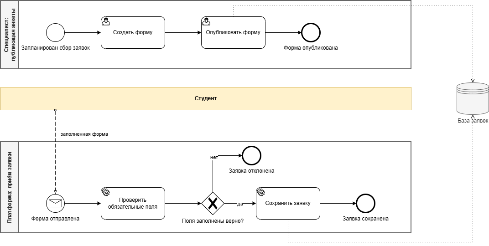
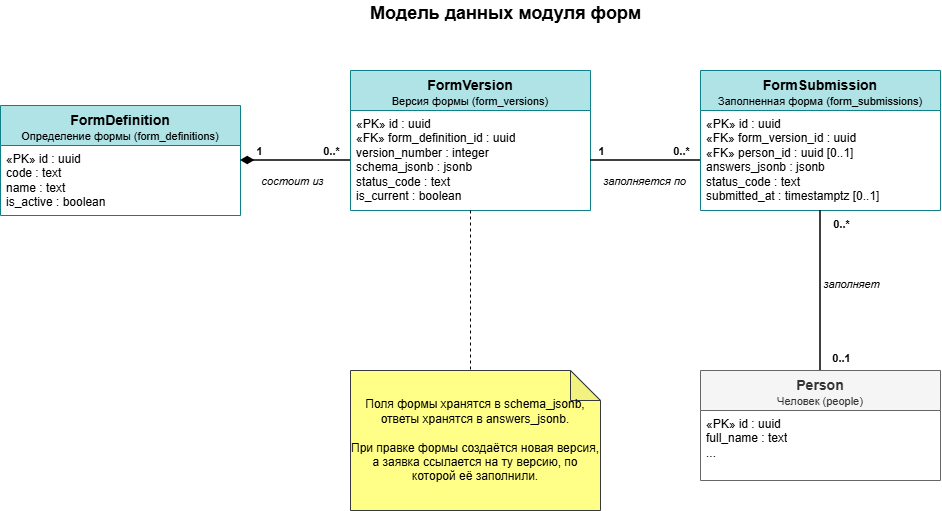

# Модуль форм: процесс и модель данных

Аналитические материалы по модулю форм веб-платформы для учёта карьерного пути студентов целевого обучения

> Схемы восстановлены мной после окончания стажировки, для портфолио. Это не официальная документация проекта: в репозитории нет кода, ТЗ и внутренних данных заказчика

## Задача

Раньше данные о студентах-целевиках хранились в Excel-реестрах, а заполненные формы собирали через сторонние сервисы и вручную переносили в таблицы. Созданный модуль решает эту проблему: специалист создаёт и публикует форму, участник заполняет её по ссылке или QR-коду, заявка сразу попадает в базу

## Процесс сбора заявок (BPMN 2.0)

- Процесс разбит на отдельные пулы: публикация формы и приём заявки - это разные процессы
- Студент показан свёрнутым пулом («чёрным ящиком»): его внутренние действия системе не важны, важно только сообщение, которое он присылает
- Приём заявки стартует по заполненной форме
- Перед шлюзом стоит сервисная задача проверки обязательных полей. Шлюз выбирает ветку: если поля не заполнены, заявка отклоняется, и студенту нужно заполнить форму заново
- Принятые заявки сохраняются в хранилище данных «База заявок»

## Модель данных (UML)

- `FormDefinition` (`form_definitions`) определение формы: код, название, активна ли она
- `FormVersion` (`form_versions`) версия формы: поля формы хранятся в `schema_jsonb`, действующая версия отмечена `is_current`
- `FormSubmission` (`form_submissions`) заполненная форма: ответы хранятся в `answers_jsonb`, статус, время отправки
- `Person` (`people`) таблица из другого раздела базы

- **JSONB** позволяет менять состав полей формы без изменения структуры базы
- **Версии** нужны, чтобы правка формы не ломала уже собранные ответы (каждая заявка ссылается на ту версию, по которой её заполнили)
- **Связь заявки с человеком необязательна** (`0..1`): форму может заполнить тот, кого ещё нет в системе

## Файлы

| Файл | Что это |
|---|---|
| `diagrams/bpmn-forms.drawio` | BPMN-схема |
| `diagrams/uml-forms.drawio` | UML-схема |
| `diagrams/*.png` | Схемы картинками |

Открыть исходник: [app.diagrams.net](https://app.diagrams.net) - «Файл» - «Открыть с устройства»

## Инструменты

draw.io, BPMN 2.0, UML, PostgreSQL (JSONB)
